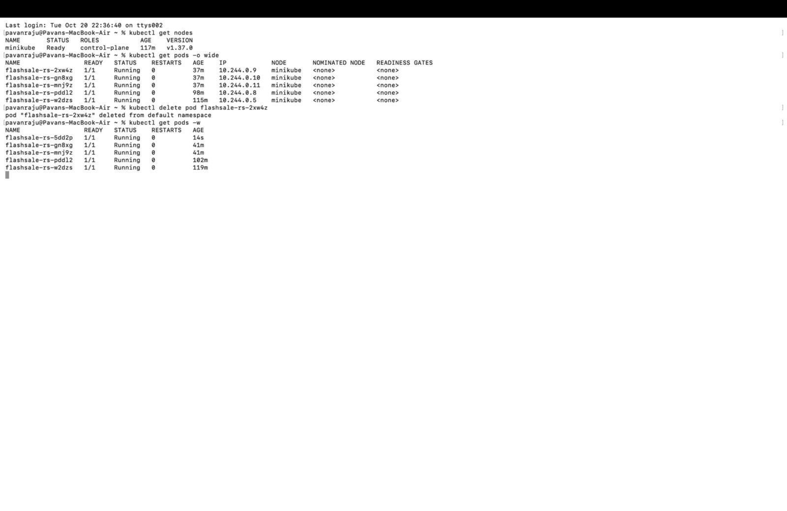
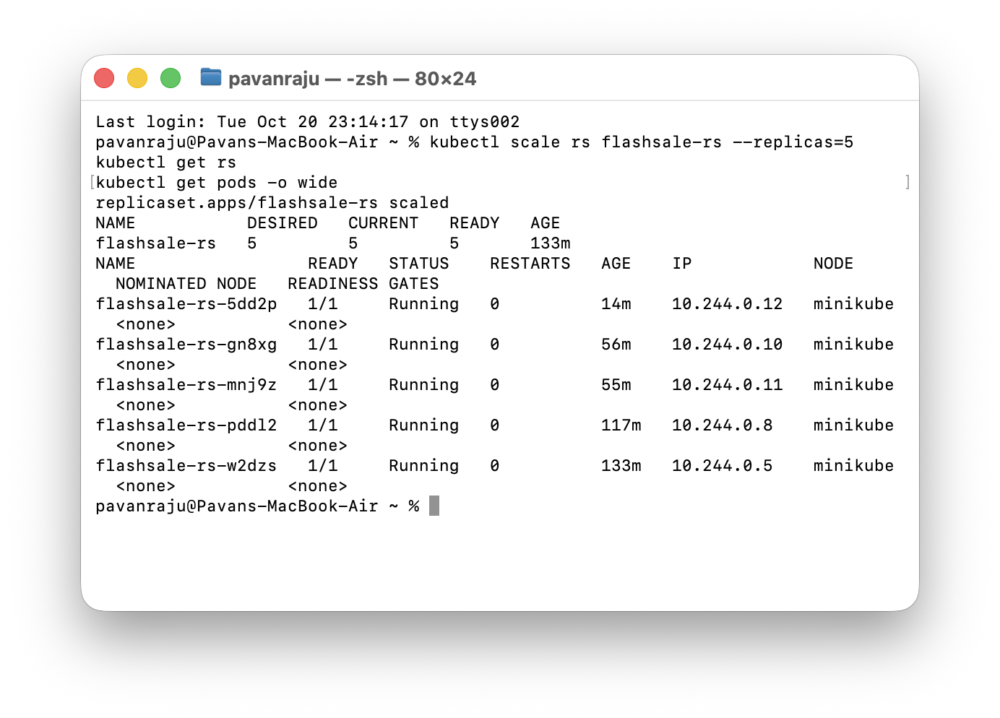
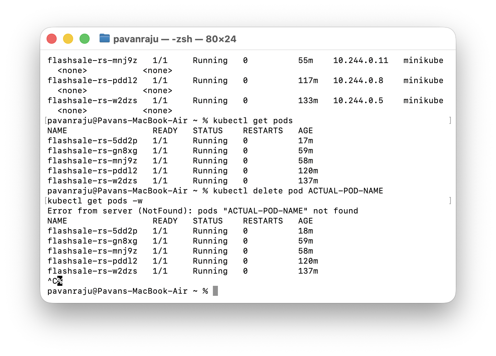

# Exercise 3: Scaling a Flask App on a Single Node Using ReplicaSets

## Real-Life Use Case: E-commerce Flash Sale

During an e-commerce flash sale, website traffic can increase suddenly. Kubernetes ReplicaSets help maintain the desired number of application Pods by creating additional Pods when scaling up and replacing deleted Pods automatically.

## Objective

- Understand how Kubernetes Pods and ReplicaSets work.
- Deploy a Flask flash-sale application using Docker.
- Run the application on a single-node Minikube cluster.
- Scale the application from 3 to 5 replicas.
- Observe Pod distribution across a single node.
- Verify automatic Pod replacement when a Pod is deleted.

## Environment

- Operating System: macOS
- Architecture: Apple Silicon (ARM64)
- Container Runtime: Docker Desktop
- Application: Python and Flask
- Containerization: Docker
- Kubernetes: Minikube (single node)
- Kubernetes CLI: kubectl
- Repository: GitHub

## Project Structure

```text
Exercise3/
├── Screenshots/
│   ├── 01-replicaset-initial-3-pods.png
│   ├── 02-scaled-to-5-replicas.png
│   └── 03-pod-self-healing.png
├── Dockerfile
├── README.md
├── app.py
└── flashsale-replicaset.yaml
```

## 1. Create the Flash Sale Application

**File:** `app.py`

The Flask application simulates a flash-sale checkout service using three routes:

- `/` — Displays a welcome message and the hostname of the Pod serving the request.
- `/buy` — Simulates a checkout and returns a randomly selected item along with the serving Pod's hostname.
- `/health` — Provides a health-check endpoint for Kubernetes readiness and liveness probes.

Displaying the hostname helps identify which Pod handles each request.

## 2. Create the Dockerfile

**File:** `Dockerfile`

```dockerfile
FROM python:3.11-slim

WORKDIR /app

COPY app.py .

RUN pip install --no-cache-dir flask gunicorn

CMD ["gunicorn", "-b", "0.0.0.0:5000", "app:app", "--workers", "1", "--threads", "2"]
```

The Dockerfile uses Python 3.11, installs Flask and Gunicorn, copies the application into the container, and starts the application on port 5000.

## 3. Start a Single-Node Minikube Cluster

Run the following commands in the terminal:

```bash
minikube stop
minikube delete
minikube start --nodes=1
kubectl get nodes
```

Verify that the Minikube node is in the `Ready` state before continuing.

## 4. Build the Docker Image

Build the image using Minikube's Docker environment so that Kubernetes can use the locally built image.

```bash
eval $(minikube docker-env)
docker build -t flashsale:1.0 .
```

The image is built locally and does not need to be pushed to Docker Hub for this exercise.

## 5. Create the ReplicaSet and Service

**File:** `flashsale-replicaset.yaml`

The Kubernetes configuration defines a ReplicaSet with an initial desired replica count of 3.

It also configures:

- Pod labels and selectors.
- The locally built Docker image.
- Container port 5000.
- Readiness and liveness probes using `/health`.
- Container resource requests and limits.
- A ClusterIP Service named `flashsale-svc` to expose the Pods internally on port 80.

The Service forwards traffic to the application containers on port 5000.

## 6. Apply the Configuration

Run:

```bash
kubectl apply -f flashsale-replicaset.yaml
```

Verify the resources:

```bash
kubectl get pods
kubectl get rs
kubectl get svc flashsale-svc
```

**Observation:** The ReplicaSet should maintain 3 desired Pods. Once all Pods are ready, the expected ReplicaSet status is `3 DESIRED / 3 CURRENT / 3 READY`.

**Screenshot: Automatic Pod Replacement**



## 7. Access and Test the Application

Start a local tunnel to the Service:

```bash
kubectl port-forward svc/flashsale-svc 8080:80
```

Keep this terminal running. Open another terminal or use your browser to test:

```bash
curl http://127.0.0.1:8080/
curl http://127.0.0.1:8080/buy
curl http://127.0.0.1:8080/health
```

The responses should confirm that the application is reachable. The `/` and `/buy` routes help demonstrate which Pod handles a request.

## 8. Scale the ReplicaSet to 5 Replicas

Run:

```bash
kubectl scale rs flashsale-rs --replicas=5
kubectl get rs
kubectl get pods
```

**Observation:** Kubernetes creates 2 additional Pods to reach the desired replica count of 5.

The ReplicaSet should report `5 DESIRED / 5 CURRENT / 5 READY` after all Pods become ready.

**Screenshot: Scaled to 5 Replicas**



## 9. Delete a Pod and Observe Self-Healing

First, list the Pods and identify one belonging to the ReplicaSet:

```bash
kubectl get pods
```

Delete one Pod using its actual name:

```bash
kubectl delete pod <pod-name>
```

Then verify the result:

```bash
kubectl get pods -o wide
kubectl get rs
```

Replace `<pod-name>` with the real name of one of your running Pods.

**Observation:** The ReplicaSet controller detects that a Pod has been deleted and creates a replacement. After the replacement becomes ready, the desired replica count returns to 5.

The replacement Pod may have a different name from the deleted Pod.

**Screenshot: Automatic Pod Replacement**



## Key Observations

- **Replica management:** The ReplicaSet maintains the specified number of Pods.
- **Scaling:** The number of Pods increases from 3 to 5 when the desired replica count is updated.
- **Self-healing:** Deleting a Pod causes Kubernetes to create a replacement automatically.
- **Single-node deployment:** All Pods are scheduled on the same Minikube node.
- **Service discovery:** The ClusterIP Service provides a stable endpoint for accessing the application.
- **Health checks:** Readiness and liveness probes use the `/health` endpoint.

## Result

Successfully deployed a Flask flash-sale application on a single-node Minikube cluster using Docker and Kubernetes. Scaled the ReplicaSet from 3 to 5 Pods and verified automatic Pod replacement after deletion.

This exercise demonstrates how Kubernetes ReplicaSets help maintain the desired application state and support scaling and resilience.

## Conclusion

Kubernetes ReplicaSets make it easier to manage application replicas, scale workloads, and recover from individual Pod failures. A Service provides a stable endpoint for accessing the application, while health probes help Kubernetes monitor application availability.
